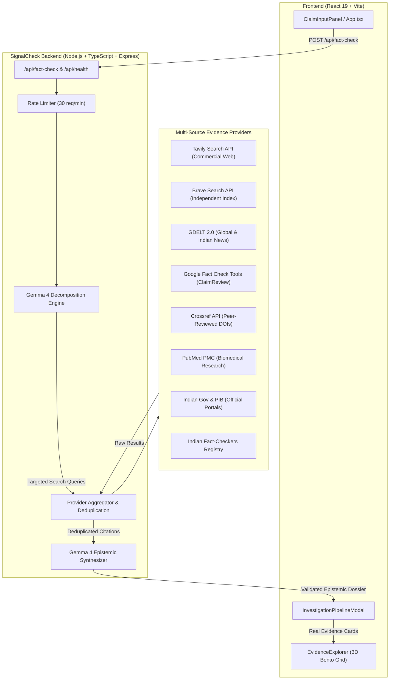

# SignalCheck — India-First AI Fact-Checking Backend

The backend engine for **SignalCheck**, an epistemic evidence-investigation platform engineered specifically for claims circulating in India. It pairs **Google Gemma 4** (`gemma-4-26b-a4b-it` via `@google/genai`) with an **8-source multi-provider retrieval pipeline** across general web indices, global news streams, academic registries, and official Indian government authorities.

---

## 🏛️ Architecture Overview



---

## 🚀 Setup & Quickstart

### 1. Requirements
- Node.js `v20.x` or `v24.x`
- npm `v10.x` or higher

### 2. Installation
```bash
# From the project root:
cd backend
npm install
```

### 3. Environment Setup
Copy the environment template:
```bash
cp .env.example .env
```
Open `.env` and configure your API keys (all commercial keys are optional; the platform starts and runs with built-in public sources even without paid API keys):

| Variable | Required? | Description | Default / Source |
| :--- | :---: | :--- | :--- |
| `PORT` | Optional | Port for the backend server | `5001` |
| `NODE_ENV` | Optional | Runtime environment | `development` |
| `FRONTEND_URL` | Optional | Allowed CORS origin for the frontend | `http://localhost:3000` |
| `GEMMA_API_KEY` | **Recommended** | Google GenAI API key for Gemma 4 | [Google AI Studio](https://aistudio.google.com/) |
| `GEMMA_MODEL_ID` | Optional | Gemma 4 model identifier | `gemma-4-26b-a4b-it` |
| `TAVILY_API_KEY` | Optional | Deep web search for LLM pipelines | [Tavily](https://tavily.com/) (1,000 free searches/mo) |
| `BRAVE_SEARCH_API_KEY` | Optional | Independent web index API | [Brave Search](https://brave.com/search/api/) (2,000 free queries/mo) |
| `GOOGLE_FACT_CHECK_API_KEY` | Optional | Access to IFCN ClaimReview records | [Google Cloud Console](https://console.cloud.google.com/) |

> **Graceful Degradation Note**: If `GEMMA_API_KEY` is not provided, the backend seamlessly switches to its built-in heuristic syntactic analysis engine, explicitly disclosing in `providerStatus.gemma` that fallback mode is active.

### 4. Running the Development Server
```bash
# Run backend with live reload
npm run dev

# Or from the project root:
npm run backend:dev
```
The backend starts on `http://localhost:5001`.

### 5. Running the Test Suite
```bash
npm test
```
Executes 23 automated end-to-end tests covering:
- Hindi Devanagari detection and query normalization
- URL sanitization, tracking parameter removal, and citation link verification
- Multi-provider evidence retrieval and syndication deduplication
- Gemma 4 epistemic verdict assignment
- Mandated uncalibrated probability disclosures

---

## 🔍 The 8 Evidence Providers

SignalCheck does not rely on a single search engine or assume any single authority is infallible:

1. **Tavily Search API**: High-precision factual web retrieval optimized for grounding AI models.
2. **Brave Search API**: Independent crawler index free from Big Tech algorithmic curation.
3. **GDELT 2.0 Doc API**: Real-time global and Indian news monitor with country filters (`sourcecountry:IN`). Free and keyless.
4. **Google Fact Check Tools API**: Direct retrieval of ClaimReview schema records published by verified fact-checkers (Alt News, BoomLive, Vishvas News, Quint WebQoof, India Today).
5. **Crossref Academic Metadata**: Millions of peer-reviewed journals and DOIs for scientific, demographic, and historical claims. Free and keyless.
6. **PubMed (NCBI PMC)**: Biomedical literature search for health claims, viral remedies, and medical treatments. Free and keyless.
7. **Indian Government Portals & PIB**: Targeted inspection of Press Information Bureau, RBI circulars, ECI notifications, IMD forecasts, and official ministry gazettes (`.gov.in`, `.nic.in`).
8. **Indian Fact-Checkers Registry**: Established Indian IFCN signatories catalogued to discover existing investigations without implying endorsement.

---

## 🛡️ Epistemic Rigor & Non-Negotiables

- **No Hallucinated Citations**: 100% of URLs, titles, and snippets are validated against real records retrieved during the search.
- **Allowed Verdicts**: Only `Supported`, `Contradicted`, `Mixed Evidence`, or `Unverified`.
- **Absence of Evidence is Not Proof of Falsity**: Unsubstantiated claims return `Unverified`, never falsely marked as disproven without contradictory evidence.
- **Uncalibrated Confidence Disclosures**: Every confidence metric includes an explicit disclaimer noting that it is a heuristic assessment and not a statistically calibrated probability.
- **Syndication Clustering**: Detects when 5 news sites reprint the exact same wire story (PTI, ANI) and avoids counting them as 5 independent primary sources.

---

## 📡 API Reference

### 1. Health Check
`GET /api/health`

**Response (`200 OK`):**
```json
{
  "status": "healthy",
  "timestamp": "2026-10-25T04:09:45.690Z",
  "uptimeSeconds": 42,
  "platform": "SignalCheck India-First Fact-Checking Platform",
  "version": "1.0.0",
  "model": {
    "primary": "gemma-4-26b-a4b-it",
    "configured": true,
    "provider": "Google GenAI SDK (@google/genai)"
  },
  "providers": {
    "tavily": false,
    "brave": false,
    "googleFactCheck": false,
    "gdelt": true,
    "crossref": true,
    "pubmed": true,
    "indianGovRegistries": true,
    "indianFactCheckers": true
  },
  "supportedLanguages": ["en", "hi"]
}
```

### 2. Conduct Fact Check
`POST /api/fact-check`

**Request Headers:**
```http
Content-Type: application/json
```

**Request Body:**
```json
{
  "claim": "क्या भारतीय रिजर्व बैंक ने 500 के नए नोट बंद करने का आदेश जारी किया है?",
  "language": "auto"
}
```

**Response (`200 OK`):**
```json
{
  "claim": "क्या भारतीय रिजर्व बैंक ने 500 के नए नोट बंद करने का आदेश जारी किया है?",
  "originalClaim": "क्या भारतीय रिजर्व बैंक ने 500 के नए नोट बंद करने का आदेश जारी किया है?",
  "language": "hi",
  "verdict": "Contradicted",
  "summary": "Retrieved evidence from official notices and fact-check records confirms that the Reserve Bank of India has issued no circular discontinuing ₹500 currency notes.",
  "confidence": {
    "score": 0.88,
    "level": "High",
    "calibrationNote": "Heuristic model assessment based on source tier agreement; not a calibrated statistical probability."
  },
  "claimBreakdown": [
    {
      "id": "sub-1",
      "statement": "भारतीय रिजर्व बैंक द्वारा 500 रुपये के नोट बंद करने की अधिसूचना जारी की गई।",
      "verdict": "Contradicted",
      "findingSummary": "आरबीआई की आधिकारिक वेबसाइट और पीआईबी फैक्ट चेक यूनिट ने इस दावे का खंडन किया है।",
      "sourceCount": 3,
      "relevantSourceIds": ["src-gen-1", "src-gen-2"]
    }
  ],
  "supportingEvidence": [],
  "contradictingEvidence": [
    {
      "id": "src-gen-1",
      "title": "Official Authority Portal: Reserve Bank of India (RBI)",
      "url": "https://rbi.org.in",
      "domain": "rbi.org.in",
      "provider": "Government of India Official Portals",
      "publicationDate": "2026-10-25",
      "retrievalTimestamp": "2026-10-25T04:10:54.247Z",
      "snippet": "Direct link to official notices, gazettes, circulars, and statements published by Reserve Bank of India (rbi.org.in).",
      "extractionType": "snippet",
      "tier": "Official Archive",
      "reliabilityNote": "Official Republic of India statutory authority.",
      "relevanceScore": 0.92,
      "stance": "contradicts"
    }
  ],
  "sources": [ ... ],
  "limitations": [
    "Always verify financial notifications on rbi.org.in before acting on circulating social media messages."
  ],
  "unresolvedQuestions": [],
  "providerStatus": {
    "gemma": { "available": true, "model": "gemma-4-26b-a4b-it", "status": "active" },
    "tavily": { "configured": false, "status": "disabled" },
    "brave": { "configured": false, "status": "disabled" },
    "googleFactCheck": { "configured": false, "status": "disabled" },
    "gdelt": { "available": true, "status": "active" },
    "crossref": { "available": true, "status": "active" },
    "pubmed": { "available": true, "status": "active" },
    "indianGov": { "available": true, "status": "active" },
    "indianFactCheckers": { "available": true, "status": "active" }
  },
  "pipelineLogs": [
    "[SignalCheck Engine] Ingesting claim: \"क्या भारतीय रिजर्व बैंक...\"",
    "[Gemma 4] Parsing logical predicates, entities, and falsifiability criteria...",
    "[Multilingual Layer] Hindi claim detected. Preserved original Devanagari text.",
    "[Retrieval Engine] Initiating multi-source evidence query across 8 specialized providers...",
    "[Indian Official Registries] Consulted government portal & PIB archives.",
    "[Gemma 4] Comparing contradiction vectors & stance alignment against 4 retrieved records...",
    "[Done] Investigation dossier compiled in 3.4s. Epistemic verdict: CONTRADICTED"
  ],
  "timestamp": "2026-10-25T04:10:54.248Z"
}
```

---

## 🚢 Deployment

### Production Build
```bash
cd backend
npm run build
npm run start
```

### Dockerfile
```dockerfile
FROM node:24-alpine
WORKDIR /app
COPY package*.json ./
RUN npm ci --omit=dev
COPY dist ./dist
ENV NODE_ENV=production
ENV PORT=5001
EXPOSE 5001
CMD ["node", "dist/server.js"]
```
